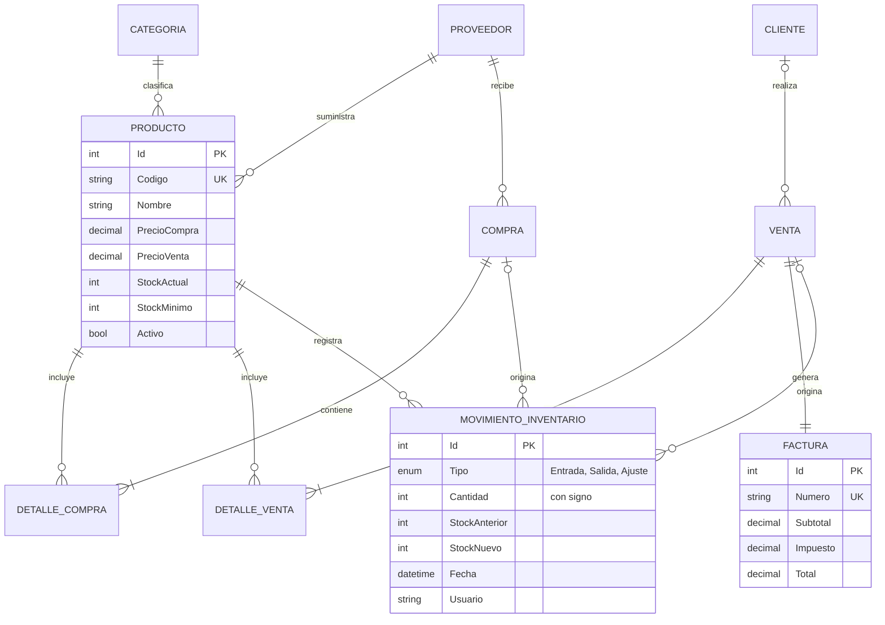

#  Sistema de Inventario y Ventas

Aplicación web de gestión de inventario, compras, ventas y facturación construida con **C#, ASP.NET Core MVC, Entity Framework Core y SQL Server**. Incluye autenticación con roles, control de existencias con trazabilidad completa, alertas de stock bajo y reportes.

> Proyecto de portafolio: diseñado para demostrar modelado de datos, reglas de negocio, seguridad por roles y buenas prácticas (pruebas unitarias, CI, integridad referencial).

##  Funcionalidades

| Módulo | Descripción |
|---|---|
| **Inicio de sesión y roles** | ASP.NET Core Identity con tres roles: `Admin`, `Vendedor`, `Almacenista`. Todo requiere sesión por defecto (*fallback policy*). |
| **Productos y categorías** | CRUD con búsqueda, filtros, validaciones de código único y activación/desactivación (sin borrados peligrosos). |
| **Control de existencias** | El stock **nunca se edita directamente**: solo cambia con compras, ventas o ajustes justificados. |
| **Compras y ventas** | Formulario dinámico de líneas; cada operación se guarda en una sola transacción (`SaveChanges`). El precio de venta lo define el servidor. |
| **Alertas de stock bajo** | Insignia en el menú, widget en el dashboard y pantalla de alertas (`StockActual <= StockMínimo`). |
| **Proveedores y clientes** | CRUD con búsqueda y estado activo/inactivo. |
| **Facturación** | Factura con numeración consecutiva (`F-000001`), IVA del 19 % y vista imprimible / guardable como PDF. |
| **Reportes** | Ventas por período con gráfico (Chart.js), productos más vendidos, inventario valorizado y exportación a CSV. |
| **Historial de movimientos** | Auditoría de entradas, salidas y ajustes con stock anterior/nuevo, referencia y usuario; filtrable. |
| **Administración de usuarios** | Alta de usuarios con asignación de rol (solo `Admin`). |

##  Matriz de permisos

| Módulo | Admin | Vendedor | Almacenista |
|---|:-:|:-:|:-:|
| Dashboard, consulta de productos y alertas | ✔ | ✔ | ✔ |
| Productos, categorías, proveedores (edición) | ✔ | — | ✔ |
| Compras, ajustes de stock y movimientos | ✔ | — | ✔ |
| Clientes, ventas y facturas | ✔ | ✔ | — |
| Reportes y usuarios | ✔ | — | — |

##  Tecnologías

- C# 12 / .NET 8 (compatible con SDK más nuevos gracias a `RollForward`)
- ASP.NET Core MVC + Razor + Bootstrap 5
- Entity Framework Core 8 (SQL Server)
- ASP.NET Core Identity
- xUnit + EF Core InMemory (pruebas de reglas de negocio)
- GitHub Actions (CI: build + tests)

##  Estructura

```
SistemaInventario/
├── SistemaInventario.sln
├── docker-compose.yml          # SQL Server opcional
├── src/Inventario.Web/
│   ├── Controllers/            # Un controlador por módulo
│   ├── Data/                   # AppDbContext + DbSeeder (datos demo)
│   ├── Models/                 # Entidades, ViewModels y roles
│   ├── Services/               # InventarioService: reglas de negocio del stock
│   ├── Components/             # ViewComponent de la insignia de alertas
│   └── Views/                  # Razor views
└── tests/Inventario.Tests/     # Pruebas unitarias del servicio
```

##  Modelo de datos



##  Cómo ejecutarlo

### Requisitos
- [.NET SDK 8 o superior](https://dotnet.microsoft.com/download)
- SQL Server: **LocalDB** (viene con Visual Studio en Windows) **o** Docker

### Opción A — SQL Server LocalDB (Windows, la más rápida)

```bash
dotnet run --project src/Inventario.Web
```

Abre <http://localhost:5080>. La base `InventarioDb` se crea sola y se cargan datos de demostración.

### Opción B — SQL Server en Docker (Windows / macOS / Linux)

```bash
docker compose up -d
```

Define la cadena de conexión (sin tocar el código):

```powershell
# PowerShell
$env:ConnectionStrings__DefaultConnection="Server=localhost,1433;Database=InventarioDb;User Id=sa;Password=Inventario_2024!;TrustServerCertificate=True"
dotnet run --project src/Inventario.Web
```

```bash
# bash / zsh
export ConnectionStrings__DefaultConnection="Server=localhost,1433;Database=InventarioDb;User Id=sa;Password=Inventario_2024!;TrustServerCertificate=True"
dotnet run --project src/Inventario.Web
```

### Usuarios de demostración

| Rol | Correo | Contraseña |
|---|---|---|
| Admin | admin@demo.com | Admin123! |
| Vendedor | vendedor@demo.com | Vendedor123! |
| Almacenista | almacen@demo.com | Almacen123! |

> Solo para desarrollo. Cambia o elimina estos usuarios antes de cualquier despliegue real.

##  Pruebas

```bash
dotnet test
```

Cubren: aumento de stock en compras, descuento y cálculo de IVA en ventas, rechazo por stock insuficiente (sin efectos secundarios), numeración consecutiva de facturas y ajustes de inventario.

##  Migraciones de EF Core (recomendado para producción)

Por defecto la app crea el esquema con `EnsureCreated`. Si generas migraciones, la app las detecta y usa `Migrate()` automáticamente:

```bash
dotnet tool install --global dotnet-ef
dotnet ef migrations add Inicial --project src/Inventario.Web
```

##  Decisiones de diseño

- **Stock auditable:** `InventarioService` es el único punto que modifica existencias y siempre crea un `MovimientoInventario` con stock anterior y nuevo.
- **Atomicidad:** cada compra/venta persiste cabecera, detalle, movimientos y factura con un único `SaveChanges`.
- **Integridad:** borrado en cascada desactivado en las relaciones del negocio; los registros se desactivan en vez de eliminarse.
- **Seguridad por defecto:** política global que exige autenticación; autorización por rol en cada controlador/acción; tokens antifalsificación en los formularios POST.
- **Precio confiable:** el precio de venta se toma de la base de datos, no del navegador.
- **Cultura fija `en-US`:** garantiza que los decimales enviados por los formularios se lean siempre con punto.

##  Ideas para evolucionar

- Concurrencia optimista (`RowVersion`) en el stock y bloqueo por producto.
- Exportación a PDF/Excel nativa (QuestPDF / ClosedXML).
- Anulación de ventas y devoluciones con movimientos inversos.
- API REST + autenticación JWT y cliente SPA.
- Dockerfile para la aplicación y despliegue en Azure.

##  Licencia

MIT
